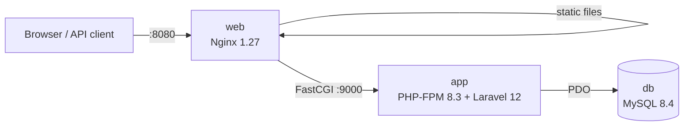

# Laravel Docker Starter

A production-shaped Laravel 12 application running on Docker: Nginx, PHP-FPM 8.3 with OPcache,
MySQL 8.4, health checks, automatic migrations, tests and a CI pipeline that builds the images
and smoke-tests the running stack.

Use it as the base for a new project, or as the target layout when moving a legacy PHP system
into containers. Maintained by [GonService](https://gonserviceit.com.br/software-sob-demanda) ·
[Português](#em-português)



## What's inside

| Area | Details |
| --- | --- |
| Images | One multi-stage [`Dockerfile`](Dockerfile): Composer deps without dev packages → `app` (PHP-FPM, non-root, OPcache + JIT) and `web` (Nginx with the public assets baked in) |
| Health | PHP-FPM ping (`/ping` via FastCGI), Nginx `/healthz`, Laravel `/up`; Compose starts each service only when its dependency is healthy |
| Startup | [`entrypoint.sh`](docker/php/entrypoint.sh) runs migrations when `RUN_MIGRATIONS=true` and caches config, routes and views outside `local` |
| Example API | `/api/tasks` CRUD with validation, filtering (`?done=1`), pagination and API resources |
| Quality | Feature tests (SQLite in memory), Laravel Pint, hadolint |
| CI | [GitHub Actions](../.github/workflows/ci.yml): tests + style, then image build, `docker compose up --wait` and HTTP smoke tests |

## Run it

Requirements: Docker with the Compose plugin. PHP and Composer on your machine are optional.

```bash
make init   # install dependencies, create .env and APP_KEY
make up     # build and start: http://localhost:8080
make test   # run the test suite
make down   # stop (make fresh also deletes the database)
```

Try the API:

```bash
curl -X POST http://localhost:8080/api/tasks \
  -H 'Accept: application/json' -H 'Content-Type: application/json' \
  -d '{"title":"Containerize the legacy app","due_date":"2026-12-01"}'

curl -H 'Accept: application/json' 'http://localhost:8080/api/tasks?done=0'
```

| Method | Path | Description |
| --- | --- | --- |
| GET | `/api/tasks` | List tasks (`done`, `per_page` up to 100) |
| POST | `/api/tasks` | Create (`title` required; `description`, `done`, `due_date` as `YYYY-MM-DD`) |
| GET | `/api/tasks/{id}` | Show one task |
| PATCH | `/api/tasks/{id}` | Partial update |
| DELETE | `/api/tasks/{id}` | Delete |

## Going to production

- Set `APP_ENV=production`, `APP_DEBUG=false` and a real `APP_KEY` and database credentials as
  secrets, not in the image.
- Run `app` with `RUN_MIGRATIONS=true` on a single replica (or as a one-off job) to avoid
  concurrent migrations.
- Use a managed MySQL (RDS, Cloud SQL) instead of the `db` container.
- The same images run on Kubernetes; a Helm deploy pipeline is available in
  [GonService/github-actions-templates](https://github.com/GonService/github-actions-templates).

## Em português

Aplicação Laravel 12 pronta para rodar em Docker como em produção: Nginx, PHP-FPM 8.3 com OPcache,
MySQL 8.4, health checks, migrações automáticas, testes e um pipeline de CI que constrói as imagens
e testa a stack rodando. Serve de base para projetos novos e de modelo para levar sistemas PHP
legados para containers. Para rodar: `make init` e `make up`, depois abra http://localhost:8080.

Tem um sistema PHP que precisa ser atualizado, colocado em containers ou levado para a nuvem? A
GonService faz isso: [gonserviceit.com.br/software-sob-demanda](https://gonserviceit.com.br/software-sob-demanda) ·
[contato@gonserviceit.com.br](mailto:contato@gonserviceit.com.br)

## License

[MIT](../LICENSE). Built on the [Laravel](https://laravel.com) framework (MIT).
