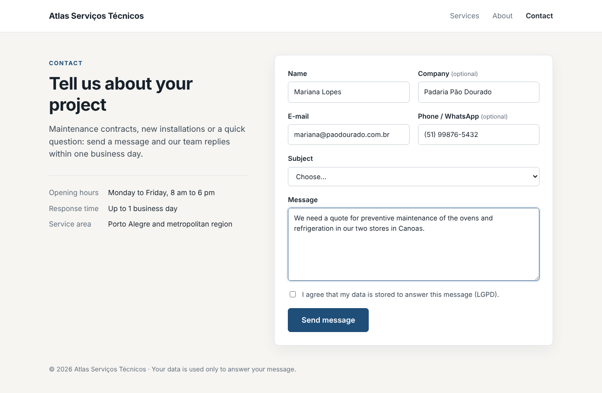
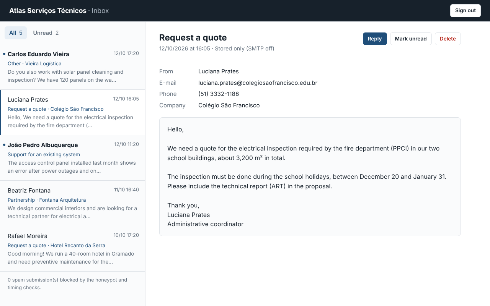

# PHP Contact Form

A secure contact form for a business website, with everything a real one needs: server-side
validation, CSRF token, honeypot and timing checks against bots, a per-IP rate limit stored in
SQLite, messages saved before any e-mail is attempted, optional SMTP notification and a
password-protected inbox to read and manage the messages. Plain PHP 8.3, no Composer packages.

Drop it into an existing site or use it as a reference for securing old `mail()` forms. Maintained
by [GonService](https://gonserviceit.com.br/software-sob-demanda) · [Português](#em-português)





## Features

| Area | Details |
| --- | --- |
| Validation | Server side in [`ContactValidator`](src/Domain/ContactValidator.php): required fields, e-mail, phone, subject list, length limits, LGPD consent; control characters stripped; the form is shown again with errors and values kept |
| CSRF | One random token per session, checked with `hash_equals` on every POST (form, inbox login and inbox actions) |
| Bots | Off-screen honeypot field plus a minimum fill time; bots get a fake "thank you" so they do not adapt, and the inbox shows how many were blocked |
| Rate limit | Sliding window in SQLite ([`RateLimiter`](src/Domain/RateLimiter.php)): 5 messages per IP per 10 minutes by default, `429` with `Retry-After`; inbox login limited too. IPs are stored only as HMAC hashes |
| Storage | Every valid message is saved to SQLite first, then e-mailed; an SMTP outage never loses a message (`mail_status` shows `sent`, `failed` or `disabled`) |
| E-mail | [`Mailer`](src/Mail/Mailer.php) interface with a small SMTP client (STARTTLS, AUTH LOGIN, UTF-8, base64 body, header-injection checks); disabled unless `SMTP_HOST` is set, and never used in tests |
| Inbox | `/inbox` behind a password (hashed with `password_hash`): all/unread filter, open marks as read, mark unread, delete, reply by e-mail |
| Output | Everything escaped with `htmlspecialchars`; CSP, `nosniff` and anti-framing headers; PRG pattern after submit |
| Tests | 30 tests, including a scripted fake SMTP server: `php tests/run.php` |

## How to use

Requirements: PHP 8.3 with `pdo_sqlite` and `mbstring`. Composer is optional.

```bash
cd php-contact-form

# 1. Set the inbox password (asked in the terminal, minimum 10 characters)
php bin/contact set-inbox-password

# 2. Optional: fictional demo messages
php bin/contact seed-demo

# 3. Start the app
php -S localhost:8000 -t public
# form:  http://localhost:8000
# inbox: http://localhost:8000/inbox
```

Messages are stored in `var/contact.sqlite` (change with `CONTACT_DB`). The company name, rate
limits and SMTP are configured with environment variables; see [`.env.example`](.env.example).

Turn on e-mail notifications (optional):

```bash
export SMTP_HOST=smtp.example.com SMTP_PORT=587 SMTP_ENCRYPTION=tls \
       SMTP_USERNAME=contato@example.com SMTP_PASSWORD='app-password' \
       MAIL_FROM=no-reply@example.com MAIL_TO=contato@example.com
php bin/contact send-test-mail     # checks the settings
php -S localhost:8000 -t public
```

Each new message is sent to `MAIL_TO` with `Reply-To` set to the visitor, so "Reply" in your mail
client answers them directly. Use port 587 with `tls` or 465 with `ssl`; most providers (Google
Workspace, Microsoft 365, Zoho, Amazon SES) need an app password or SMTP credentials.

Run the tests:

```bash
php tests/run.php          # or: composer test
php tests/run.php Mail     # only the e-mail tests
```

Run with Docker (Apache + PHP 8.3 as `www-data` on port 8080):

```bash
docker build -t php-contact-form .
cp .env.example .env               # then edit it (remove SMTP_HOST to keep e-mail off)
docker volume create contact-data
docker run --rm -v contact-data:/var/www/html/var -e INBOX_PASSWORD='a-long-password' \
  php-contact-form php bin/contact set-inbox-password
docker run -d --name contact -p 8080:8080 -v contact-data:/var/www/html/var \
  --env-file .env php-contact-form
# http://localhost:8080 (health check: /healthz)
```

Behind a load balancer or reverse proxy, set `TRUSTED_PROXIES` to its address so the rate limit
uses the visitor's IP from `X-Forwarded-For` instead of the proxy's. Run `php bin/contact prune`
from cron once a day to clean old rate-limit entries.

Stack: PHP 8.3 · SQLite (PDO) · plain PHP templates and CSS · SMTP · Apache in Docker · GitHub Actions

## Em português

Formulário de contato seguro para o site de uma empresa: validação no servidor, token CSRF, campo
isca (honeypot) e tempo mínimo de preenchimento contra robôs, limite de envios por IP guardado no
SQLite, mensagens salvas no banco antes de qualquer envio de e-mail (uma falha no SMTP não perde a
mensagem), notificação por SMTP opcional e uma caixa de entrada protegida por senha para ler,
marcar como lida ou não lida e excluir as mensagens. Os IPs são guardados só como hash, e o
formulário pede o consentimento do visitante (LGPD). É PHP 8.3 puro, sem dependências do Composer.

Como usar:

1. Defina a senha da caixa de entrada: `php bin/contact set-inbox-password`.
2. Se quiser mensagens de exemplo: `php bin/contact seed-demo`.
3. Suba com `php -S localhost:8000 -t public`; o formulário fica em http://localhost:8000 e a
   caixa de entrada em http://localhost:8000/inbox.
4. Para receber cada mensagem por e-mail, preencha as variáveis `SMTP_*`, `MAIL_FROM` e `MAIL_TO`
   (veja o `.env.example`) e teste com `php bin/contact send-test-mail`.
5. Testes: `php tests/run.php`. Docker: `docker build -t php-contact-form .` e os comandos acima.

Seu site ainda usa um formulário antigo que recebe spam ou deixa mensagens se perderem? A
GonService resolve: [gonserviceit.com.br/software-sob-demanda](https://gonserviceit.com.br/software-sob-demanda) ·
[contato@gonserviceit.com.br](mailto:contato@gonserviceit.com.br)

## License

[MIT](../LICENSE)
