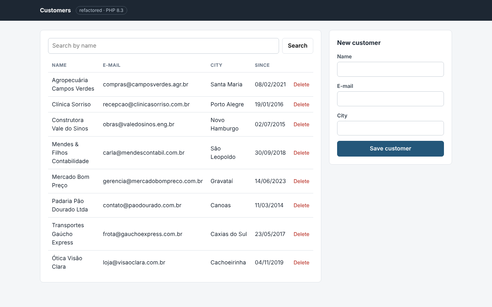
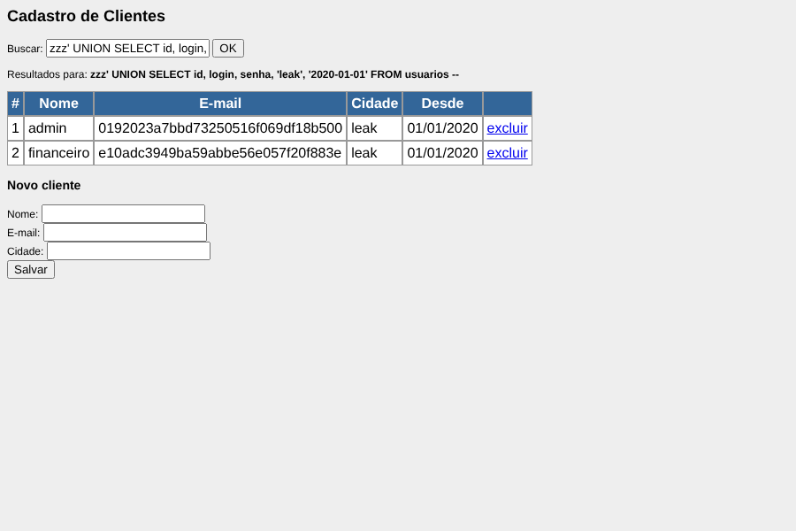

# PHP Legacy Modernization

A before-and-after case of a typical legacy PHP page: a customer list with search, add and delete,
written in one file with SQL built by string concatenation, HTML mixed with logic and nothing
escaped. [`before/`](before) keeps it exactly as "found"; [`after/`](after) is the same feature,
on the same database, refactored step by step into modern PHP 8.3 with tests that send the same
attacks to both versions.

Use it to understand what we do when we take over an old PHP system. Maintained by
[GonService](https://gonserviceit.com.br/software-sob-demanda) · [Português](#em-português)

> **Warning:** everything in `before/` is deliberately insecure. It has no Dockerfile, is excluded
> from the image by `.dockerignore`, blocks Apache with `.htaccess`, and its `guard.php` refuses
> to run anywhere except PHP's built-in server on `127.0.0.1` with `LEGACY_DEMO=1`. Never deploy it.

The refactored page (`after/`):



The legacy page (`before/`) after searching for
`zzz' UNION SELECT id, login, senha, 'leak', '2020-01-01' FROM usuarios --`: the search box hands
over the back-office users and their password hashes.



## Vulnerabilities fixed

| # | Problem in `before/clientes.php` | Attack (tested) | Fix in `after/` |
| --- | --- | --- | --- |
| 1 | SQL injection in the search: `LIKE '%" . $_GET['busca'] . "%'` | `UNION SELECT ... FROM usuarios` leaks password hashes; `' OR 1=1` returns every row | Prepared statement with a bound value, LIKE wildcards escaped ([`CustomerRepository`](after/src/Customers/CustomerRepository.php)) |
| 2 | SQL injection in the insert: `VALUES ('" . $_POST['nome'] . "', ...` | Quotes break the query; crafted values change it | Named placeholders; `O'Brien'); DROP TABLE clientes; --` is stored as plain text |
| 3 | SQL injection in the delete: `WHERE id = " . $_GET['excluir']` | `?excluir=0 OR 1=1` deletes every customer | Route accepts digits only, id bound as a parameter, one row at most |
| 4 | Reflected XSS: the search term is echoed raw | `<script>` in the URL runs in the victim's browser | Every value printed through `htmlspecialchars` ([`View::e()`](after/src/Support/View.php)), plus a Content-Security-Policy |
| 5 | Stored XSS: names, e-mails and cities printed raw | A customer named `` attacks every visitor | Same escaping on all output |
| 6 | CSRF: delete is a GET link, the add form has no token | A link or image on another site deletes or creates customers | Delete is `POST` only; both forms carry a session token checked with `hash_equals` |
| 7 | No validation | Empty names, invalid e-mails, unlimited lengths | [`CustomerService::validate()`](after/src/Customers/CustomerService.php) with per-field messages (`422`), values kept in the form |
| 8 | Error disclosure: `die(print_r($db->errorInfo()) . $sql)` | Typing `'` shows the SQL and table names | PDO in exception mode, details only in the log, a generic error page for the visitor |
| 9 | Notices hidden with `error_reporting(...)`, no types | Bugs stay invisible | `declare(strict_types=1)`, typed properties, readonly classes; no warnings silenced |

Not fixed here (out of the scope of this page, listed for the next step): the `usuarios` table
stores unsalted MD5 passwords; they should be rehashed with `password_hash()` on next login.

## Step by step

Each step keeps the page working, so it can be deployed and verified on its own:

1. **Freeze the behaviour.** Write characterization tests against the old page first:
   [`tests/LegacyTest.php`](tests/LegacyTest.php) runs `before/clientes.php` in a subprocess on a
   throwaway database and records what it does today, attacks included.
2. **Single entry point.** Add a front controller ([`after/public/index.php`](after/public/index.php))
   and a small router so each action has its own method and URL: `GET /`, `POST /customers`,
   `POST /customers/{id}/delete`. Only `public/` is web-accessible.
3. **Move SQL into a repository.** Every query goes to [`CustomerRepository`](after/src/Customers/CustomerRepository.php)
   with prepared statements and `ATTR_EMULATE_PREPARES=false`. The database schema does not change,
   so the old and new pages can run side by side during the migration.
4. **Name the rules.** [`CustomerService`](after/src/Customers/CustomerService.php) validates
   input and returns a typed `NewCustomer`; invalid data raises a `ValidationException` with
   messages per field.
5. **Separate HTML.** Templates in [`after/templates/`](after/templates) receive ready data and print
   it only through `$this->e()`. No SQL or `$_GET` in the HTML anymore.
6. **Protect state changes.** CSRF token on every form, delete turned into a `POST`,
   Post/Redirect/Get after saving so a refresh does not resubmit.
7. **Handle errors.** Exceptions are logged with details and the visitor sees a generic page.
8. **Prove it.** [`tests/AfterTest.php`](tests/AfterTest.php) sends the same payloads to the new
   page: the UNION injection returns no rows and no hashes, quotes are stored literally, the delete
   link no longer works, scripts come out escaped.
9. **Package it.** The [`Dockerfile`](Dockerfile) ships only `after/` (Apache, non-root, health
   check), and CI runs lint and tests on every push.

## How to use

Requirements: PHP 8.3 with `pdo_sqlite` and `mbstring`.

```bash
cd php-legacy-modernization

# 1. Create the demo database (shared by both versions)
php bin/setup-db                # --fresh recreates it

# 2. Run the refactored page: http://localhost:8000
php -S localhost:8000 -t after/public

# 3. Optional, on your machine only: the insecure original at http://127.0.0.1:8001/clientes.php
LEGACY_DEMO=1 php -S 127.0.0.1:8001 -t before
```

Try the same search in both: `zzz' UNION SELECT id, login, senha, 'leak', '2020-01-01' FROM usuarios --`.

Run the tests (they attack both versions on temporary databases):

```bash
php tests/run.php          # or: composer test
php tests/run.php After    # only the refactored app
```

Run the refactored app with Docker (Apache + PHP 8.3 as `www-data` on port 8080):

```bash
docker build -t php-legacy-modernization .
docker volume create legacy-data
docker run --rm -v legacy-data:/var/www/app/var php-legacy-modernization php bin/setup-db
docker run -d --name customers -p 8080:8080 -v legacy-data:/var/www/app/var php-legacy-modernization
# http://localhost:8080 (health check: /healthz)
```

Stack: PHP 8.3 · SQLite (PDO) · plain PHP templates · Apache in Docker · GitHub Actions

## Em português

Um caso de antes e depois de uma página PHP legada típica: cadastro de clientes com busca,
inclusão e exclusão, escrito num arquivo só, com SQL montado por concatenação, HTML misturado com
a lógica e nada escapado. A pasta `before/` guarda o código como foi "encontrado" (com SQL
injection, XSS, CSRF e exibição de erros com o SQL) e a pasta `after/` tem a mesma funcionalidade,
no mesmo banco de dados, refatorada passo a passo: PDO com prepared statements, separação em
repositório, serviço e templates, validação, escape de saída, token CSRF e testes que mandam os
mesmos ataques para as duas versões. A tabela acima lista cada vulnerabilidade, o ataque testado
e a correção.

Como usar:

1. Crie o banco de demonstração: `php bin/setup-db`.
2. Rode a versão refatorada com `php -S localhost:8000 -t after/public` e abra http://localhost:8000.
3. Se quiser ver a versão insegura, só na sua máquina: `LEGACY_DEMO=1 php -S 127.0.0.1:8001 -t before`
   e abra http://127.0.0.1:8001/clientes.php. Ela não tem Dockerfile e se recusa a rodar fora disso.
4. Testes: `php tests/run.php`. Docker (só a versão nova): `docker build -t php-legacy-modernization .`.

Tem um sistema PHP antigo funcionando, mas com medo de mexer? A GonService moderniza aos poucos,
com testes e sem parar a operação: [gonserviceit.com.br/software-sob-demanda](https://gonserviceit.com.br/software-sob-demanda) ·
[contato@gonserviceit.com.br](mailto:contato@gonserviceit.com.br)

## License

[MIT](../LICENSE)
