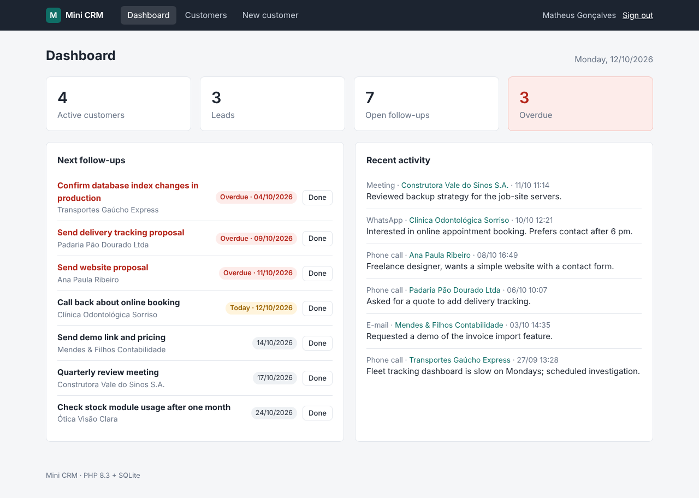
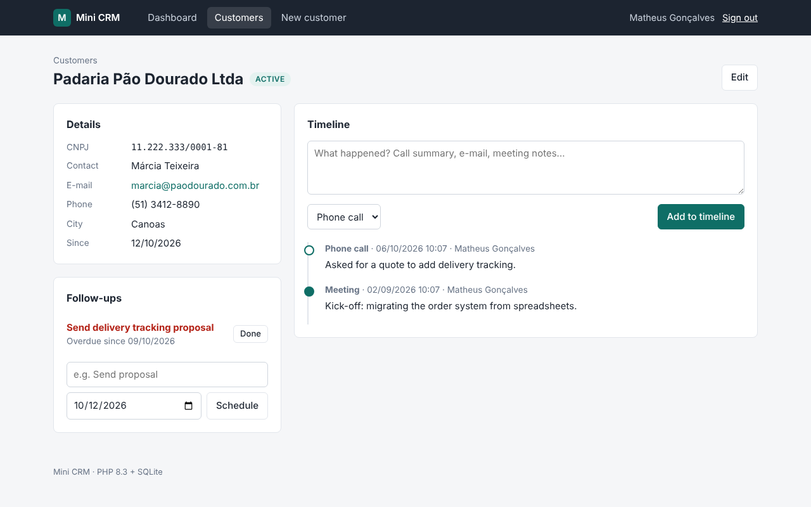

# PHP Mini CRM

A small CRM for service companies: customers with CPF/CNPJ check-digit validation, a timeline of
calls, e-mails, meetings and notes, and follow-up reminders that turn red when they are overdue.
Plain PHP 8.3 and SQLite, no framework and no Composer packages, so it runs anywhere PHP runs.

Built to show clean, secure server-side PHP that a small team can read in an afternoon. Maintained
by [GonService](https://gonserviceit.com.br/software-sob-demanda) · [Português](#em-português)



<details>
<summary>Customer page: details, follow-ups and interaction timeline</summary>



</details>

## Features

| Area | Details |
| --- | --- |
| Customers | Name, CPF or CNPJ, contact person, e-mail, phone, city and status (lead, active, inactive) |
| CPF / CNPJ | Check-digit validation in [`Document`](src/Domain/Document.php), including the alphanumeric CNPJ format (`12.ABC.345/01DE-35`); duplicates are refused |
| Timeline | Phone calls, e-mails, meetings, WhatsApp messages and notes, newest first, with author and time |
| Follow-ups | Reminders with a due date; overdue ones are highlighted on the dashboard and in the customer list |
| Search | Free text over name, contact, e-mail, city and document, plus status and follow-up filters |
| Security | Login with `password_hash`, session id regenerated on login, CSRF token on every form, all output escaped, PDO prepared statements, CSP and anti-framing headers |
| Code | Front controller, a 40-line router, repositories over PDO, plain PHP templates, enums and readonly classes |
| Tests | 29 tests (domain + HTTP) with a self-contained runner: `php tests/run.php` |

## How to use

Requirements: PHP 8.3 with `pdo_sqlite` and `mbstring`. Composer is optional.

```bash
cd php-mini-crm

# 1. Create the admin user (asks for the password, minimum 10 characters)
php bin/crm create-admin admin@example.com "Your Name"

# 2. Optional: load fictional demo customers, notes and follow-ups
php bin/crm seed-demo

# 3. Start the app and open http://localhost:8000
php -S localhost:8000 -t public
```

The database is created in `var/crm.sqlite`; set `CRM_DB=/path/to/file.sqlite` to change it. For
scripts, the password can come from the environment:
`CRM_ADMIN_PASSWORD='a-long-password' php bin/crm create-admin admin@example.com "Admin"`.
Running `create-admin` again with the same e-mail resets the password.

Other commands:

```bash
php bin/crm check-document 11.222.333/0001-81   # valid CNPJ 11.222.333/0001-81
php bin/crm help
```

Run the tests:

```bash
php tests/run.php          # or: composer test
php tests/run.php HTTP     # only tests whose name contains "HTTP"
```

Run with Docker (Apache + PHP 8.3 as `www-data` on port 8080, data in a volume):

```bash
docker build -t php-mini-crm .
docker volume create crm-data
docker run --rm -v crm-data:/var/www/html/var -e CRM_ADMIN_PASSWORD='a-long-password' \
  php-mini-crm php bin/crm create-admin admin@example.com "Admin"
docker run -d --name crm -p 8080:8080 -v crm-data:/var/www/html/var php-mini-crm
# http://localhost:8080 (health check: /healthz)
```

| Method | Path | Description |
| --- | --- | --- |
| GET/POST | `/login` | Sign in |
| POST | `/logout` | Sign out |
| GET | `/` | Dashboard: counters, next follow-ups, recent activity |
| GET | `/customers` | List with `q`, `status` and `follow_up=open\|overdue` filters |
| GET/POST | `/customers/new`, `/customers` | Create a customer |
| GET | `/customers/{id}` | Details, follow-ups and timeline |
| GET/POST | `/customers/{id}/edit`, `/customers/{id}` | Edit |
| POST | `/customers/{id}/interactions` | Add a timeline entry |
| POST | `/customers/{id}/reminders` | Schedule a follow-up |
| POST | `/reminders/{id}/done` | Mark a follow-up as done |
| GET | `/healthz` | Health check (no login) |

Stack: PHP 8.3 · SQLite (PDO) · plain PHP templates and CSS · Apache in Docker · GitHub Actions

## Em português

CRM simples para empresas de serviços: cadastro de clientes com validação de CPF e CNPJ (inclusive
o CNPJ alfanumérico), linha do tempo com ligações, e-mails, reuniões, WhatsApp e anotações, e
lembretes de retorno que ficam em vermelho quando estão atrasados. Tem busca por nome, contato,
e-mail, cidade ou documento, filtros por status e por retornos atrasados, e login com senha
protegida por hash, tokens CSRF em todos os formulários e saída escapada contra XSS. É PHP 8.3 puro
com SQLite, sem framework e sem dependências do Composer.

Como usar:

1. Crie o usuário administrador: `php bin/crm create-admin admin@exemplo.com.br "Seu Nome"` (a
   senha é pedida no terminal e precisa ter pelo menos 10 caracteres).
2. Se quiser dados de exemplo: `php bin/crm seed-demo`.
3. Suba o servidor com `php -S localhost:8000 -t public` e abra http://localhost:8000.
4. Testes: `php tests/run.php`. Docker: `docker build -t php-mini-crm .` e os comandos acima.

Precisa de um sistema sob medida para a sua empresa ou de ajuda com um sistema PHP existente? Fale
com a GonService: [gonserviceit.com.br/software-sob-demanda](https://gonserviceit.com.br/software-sob-demanda) ·
[contato@gonserviceit.com.br](mailto:contato@gonserviceit.com.br)

## License

[MIT](../LICENSE)
