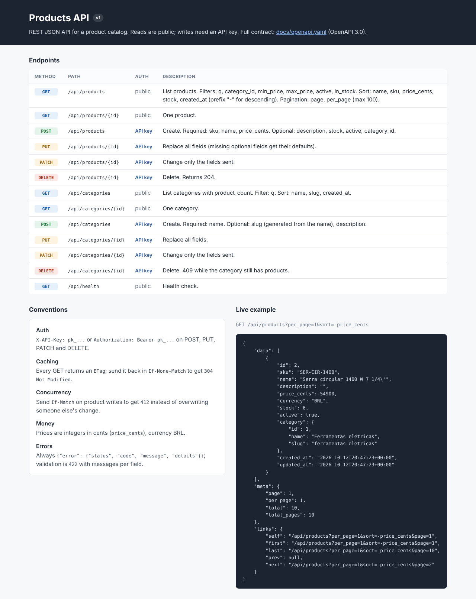

# PHP Products API

A REST JSON API for a product catalog in plain PHP 8.3: CRUD for products and categories,
validation errors in one consistent JSON shape, pagination, filtering and sorting, API-key
authentication for write routes, ETag caching with `If-None-Match`, optimistic locking with
`If-Match`, and an [OpenAPI 3 contract](docs/openapi.yaml). No framework, no Composer packages.

A small, readable example of the API you would put behind an e-commerce site, an ERP integration
or a mobile app. Maintained by [GonService](https://gonserviceit.com.br/software-sob-demanda) ·
[Português](#em-português)



## Features

| Area | Details |
| --- | --- |
| Routing | [`Router`](src/Http/Router.php) with `{id}` placeholders; `404` for unknown paths, `405` with an `Allow` header for wrong methods |
| CRUD | Products (`sku`, `name`, `description`, `price_cents`, `stock`, `active`, `category_id`) and categories (`name`, `slug`, `description`); `POST` gives `201` + `Location`, `PUT` replaces, `PATCH` changes only what is sent, `DELETE` gives `204` |
| Errors | Always `{"error": {"status", "code", "message", "details"}}`: `400` invalid JSON, `401`, `404`, `405`, `409` category in use, `412`, `415` wrong content type, `422` validation with messages per field, `500` without internals |
| Validation | Strict types (`"19.9"` is not a price), length and range limits, unique SKU and slug, existing category, unknown and read-only fields rejected |
| Lists | `page` / `per_page` (max 100), `meta` with totals and `links` (first, prev, next, last); filters `q`, `category_id`, `min_price`, `max_price`, `active`, `in_stock`; `sort=-price_cents,name` from a whitelist |
| Auth | `X-API-Key` or `Authorization: Bearer` on POST, PUT, PATCH and DELETE; keys are random, shown once and stored as SHA-256 hashes; revocable from the CLI |
| HTTP caching | Strong `ETag` on every GET (lists too), `304 Not Modified` for `If-None-Match`; `If-Match` on product writes returns `412` when someone changed the product first |
| Security | PDO prepared statements everywhere, `ORDER BY` built only from whitelisted columns, LIKE wildcards escaped |
| Docs | [`docs/openapi.yaml`](docs/openapi.yaml) (validated with openapi-spec-validator), an HTML endpoint list at `/` and the raw contract at `/openapi`; a test checks that the contract and the router list the same routes |
| Tests | 23 tests through the whole HTTP stack, in-memory SQLite: `php tests/run.php` |

## How to use

Requirements: PHP 8.3 with `pdo_sqlite` and `mbstring`. Composer is optional.

```bash
cd php-products-api

# 1. Optional: load a fictional catalog (hardware store, prices in BRL cents)
php bin/api seed-demo

# 2. Create an API key for write routes (copy it, it is shown only once)
php bin/api create-key my-laptop

# 3. Start the API and open http://localhost:8000 for the endpoint list
php -S localhost:8000 -t public
```

The database is `var/catalog.sqlite` (change with `API_DB`). Keys can be listed with
`php bin/api list-keys` and revoked with `php bin/api revoke-key <id>`.

Try it:

```bash
KEY=pk_paste_your_key_here

# Read (public): filter, sort and paginate
curl 'http://localhost:8000/api/products?q=led&sort=-price_cents&per_page=5'
curl 'http://localhost:8000/api/products?category_id=2&min_price=1000&max_price=5000'

# Create
curl -i -X POST http://localhost:8000/api/products \
  -H "X-API-Key: $KEY" -H 'Content-Type: application/json' \
  -d '{"sku":"FIT-ISO-19","name":"Fita isolante 19 mm x 20 m","price_cents":790,"stock":120,"category_id":2}'

# Change only the price
curl -X PATCH http://localhost:8000/api/products/1 \
  -H "Authorization: Bearer $KEY" -H 'Content-Type: application/json' -d '{"price_cents":27990}'

# Conditional GET: send the ETag back and get 304 Not Modified
ETAG=$(curl -sI http://localhost:8000/api/products/1 | grep -i '^etag' | cut -d' ' -f2 | tr -d '\r')
curl -i -H "If-None-Match: $ETAG" http://localhost:8000/api/products/1
```

A validation error looks like this (`422`):

```json
{
  "error": {
    "status": 422,
    "code": "validation_failed",
    "message": "The given data was invalid.",
    "details": {
      "sku": ["Another product already uses this SKU."],
      "price_cents": ["Must be an integer."],
      "colour": ["Unknown field."]
    }
  }
}
```

Run the tests:

```bash
php tests/run.php          # or: composer test
php tests/run.php ETag     # only tests whose name contains "ETag"
```

Run with Docker (Apache + PHP 8.3 as `www-data` on port 8080, data in a volume):

```bash
docker build -t php-products-api .
docker volume create catalog-data
docker run --rm -v catalog-data:/var/www/html/var php-products-api php bin/api seed-demo
docker run --rm -v catalog-data:/var/www/html/var php-products-api php bin/api create-key docker
docker run -d --name products-api -p 8080:8080 -v catalog-data:/var/www/html/var php-products-api
curl http://localhost:8080/api/health
```

Import [`docs/openapi.yaml`](docs/openapi.yaml) into Postman, Insomnia or Swagger UI to explore
the API or generate a client.

Stack: PHP 8.3 · SQLite (PDO) · JSON · OpenAPI 3.0 · Apache in Docker · GitHub Actions

## Em português

API REST em JSON para um catálogo de produtos, em PHP 8.3 puro: cadastro (CRUD) de produtos e
categorias, erros de validação sempre no mesmo formato (`422` com mensagens por campo), paginação,
filtros (texto, categoria, faixa de preço, ativo, em estoque) e ordenação, autenticação por chave
de API nas rotas de escrita, cache HTTP com `ETag`/`If-None-Match` (`304`), controle de
concorrência com `If-Match` (`412`) e o contrato completo em OpenAPI 3 (`docs/openapi.yaml`). Os
preços são inteiros em centavos (BRL) para evitar erros de arredondamento.

Como usar:

1. Se quiser um catálogo de exemplo: `php bin/api seed-demo`.
2. Crie uma chave de API para as rotas de escrita: `php bin/api create-key meu-computador` (ela
   aparece uma única vez).
3. Suba com `php -S localhost:8000 -t public` e abra http://localhost:8000 para ver a lista de
   rotas; os exemplos com `curl` acima mostram leitura, criação, alteração e o `304`.
4. Testes: `php tests/run.php`. Docker: `docker build -t php-products-api .` e os comandos acima.

Precisa integrar sua loja, ERP ou aplicativo com uma API bem documentada? Fale com a GonService:
[gonserviceit.com.br/software-sob-demanda](https://gonserviceit.com.br/software-sob-demanda) ·
[contato@gonserviceit.com.br](mailto:contato@gonserviceit.com.br)

## License

[MIT](../LICENSE)
